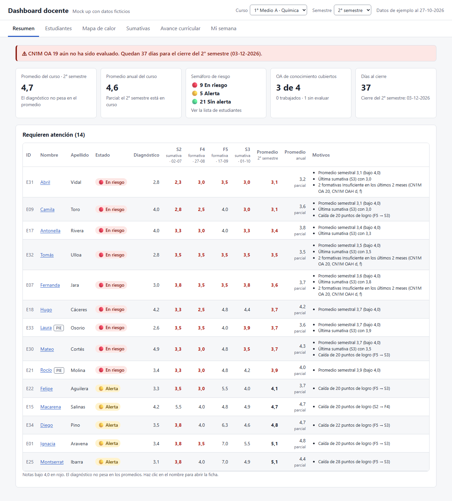
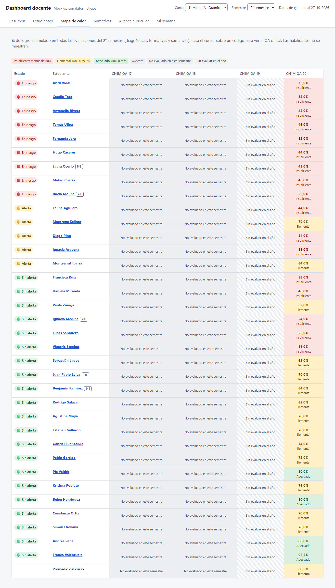

# Dashboard docente

Dashboard para que docentes de una plataforma de evaluación (diagnósticas, formativas y sumativas) analicen los resultados de sus estudiantes durante el semestre y tomen decisiones pedagógicas a tiempo.

El proyecto se documenta con **Spec-Driven Development (SDD)**: Constitución → Especificar → Planificar → Tareas → Implementar.

> Todos los datos de estudiantes de este repositorio son **ficticios**.

## Estado

- **Mock up terminado** (27-10-2026), listo para validar con docentes.
- La etapa 1 es la vista del docente de asignatura. La vista del equipo directivo será una etapa posterior.

## Ver el mock up

Abre [`mockup/dashboard-docente.html`](mockup/dashboard-docente.html) en el navegador con doble clic. No necesita servidor ni internet.

- Agrega `?verificar` a la dirección para ver las 76 pruebas de las reglas de cálculo.
- Puedes abrir una pestaña directamente, por ejemplo `dashboard-docente.html#heatmap`.

| Resumen | Mapa de calor |
|---|---|
|  |  |

Todas las capturas están en [`docs/capturas/`](docs/capturas/).

## Documentos

| Documento | Contenido |
|---|---|
| [`.specify/constitution.md`](.specify/constitution.md) | Reglas fijas del proyecto: escala de notas chilena, promedios, semáforo de riesgo, privacidad y límites para el agente de IA |
| [`contexto-proyecto.md`](contexto-proyecto.md) | Contexto de negocio, datos disponibles, decisiones del Product Owner y preguntas abiertas |
| [`specs/001-dashboard-docente/spec.md`](specs/001-dashboard-docente/spec.md) | Requerimientos e historias de usuario (9 épicas, 22 historias) |
| [`specs/001-dashboard-docente/plan.md`](specs/001-dashboard-docente/plan.md) | Plan técnico del mock up |
| [`specs/001-dashboard-docente/tasks.md`](specs/001-dashboard-docente/tasks.md) | Las 28 tareas del mock up, todas terminadas |
| [`export/memoria-sesion-2026-10-27.md`](export/memoria-sesion-2026-10-27.md) | Resumen de la sesión de trabajo con el asistente de IA |

## Estructura

```
.specify/           Constitución del proyecto
specs/              Una carpeta por funcionalidad: spec, plan y tareas
mockup/             Mock up HTML y script de preparación de datos
data/               Planilla de ejemplo, OA oficiales MINEDUC y datos generados (ficticios)
docs/capturas/      Capturas del mock up
export/             Memoria de la sesión de trabajo
```

## Regenerar los datos del mock up

Si cambia la planilla de `data/`, el script vuelve a generar los datos y los inserta en el HTML (Windows PowerShell):

```powershell
powershell -ExecutionPolicy Bypass -File mockup/scripts/extract-data.ps1
```

## Lo que no está en este repositorio

- `inputs/`: material de referencia privado (fotos de un curso y el mensaje de una docente). Sus conclusiones están documentadas en `contexto-proyecto.md`.
- La transcripción completa de la sesión, que se entrega por separado.
